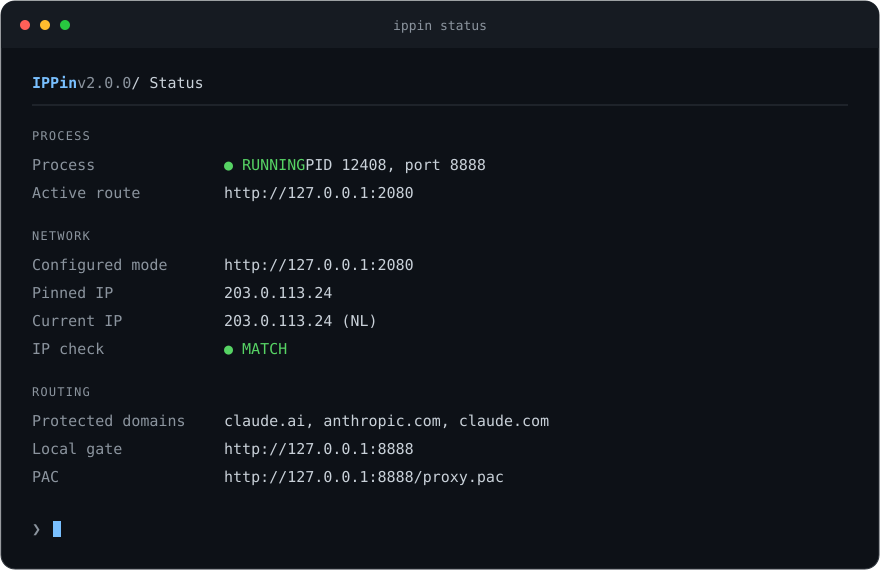

<div align="center">

# 🛡️ IPPin

### Один привязанный IP для выбранных сервисов

Локальный прокси на **Rust**, который проверяет внешний IP перед допуском трафика.<br>
Для браузеров, Claude Code, Cursor и собственных API-клиентов.

[](https://www.rust-lang.org/)
[](https://github.com/chi2l3s/ippin/releases)
[](https://github.com/chi2l3s/ippin/actions/workflows/ci.yml)
[](https://github.com/chi2l3s/ippin/releases)

[Установка](#установка) · [Быстрый старт](#быстрый-старт) · [Команды](#команды) · [API](#anthropic-api) · [Как работает](#как-это-работает)

</div>

---

## Что умеет IPPin

| | Возможность |
| :---: | :--- |
| **IP** | Проверяет привязанный адрес перед каждым новым запросом |
| **TCP** | Закрывает активные CONNECT-соединения и HTTP/API-потоки при провале проверки |
| **VPN** | Работает через TUN, локальный HTTP-прокси или SOCKS5 |
| **PAC** | Направляет выбранные домены через IPPin, включая их поддомены |
| **API** | Предоставляет локальный шлюз для `api.anthropic.com` с потоковыми ответами |
| **WIN** | Запускается в фоне и при входе в Windows, сохраняет прежние настройки прокси |

> **Граница защиты.** IPPin контролирует запросы, направленные через него. Проверка IP по таймеру не даёт гарантии отсутствия каждого пакета с другого адреса. Для строгого запрета утечек нужны сетевые правила ОС/VPN. [Подробнее о границах защиты ↓](#границы-защиты)

## Установка

### Windows · одна команда

Откройте PowerShell и выполните:

```powershell
irm https://raw.githubusercontent.com/chi2l3s/ippin/main/install.ps1 | iex
```

Установщик сам выберет **AMD64 / ARM64**, скачает опубликованный Rust-релиз, проверит **SHA256** и добавит `ippin` в `PATH`. Права администратора и установленный Rust для этого не нужны. Команда `ippin` будет доступна в текущем терминале.

> Команда использует файлы из GitHub. Для установки этой версии там должны быть опубликованы обновлённый `install.ps1` и Rust-релиз **v2.0.0 или новее** с архивом и `checksums.txt`. Старые Go-релизы установщик отклоняет.

<details>
<summary><strong>Определённая версия, свой каталог или установка без изменения PATH</strong></summary>

Скачанный скрипт принимает те же параметры, что и локальный:

```powershell
& ([scriptblock]::Create((irm https://raw.githubusercontent.com/chi2l3s/ippin/main/install.ps1))) -Version v2.0.0
```

Или из клонированного репозитория:

```powershell
.\install.ps1 -Version v2.0.0 -InstallDir "$env:LOCALAPPDATA\Programs\ippin"
.\install.ps1 -NoPathUpdate
```

По умолчанию файл устанавливается в `%LOCALAPPDATA%\Programs\ippin`. Перед обновлением остановите процесс командой `ippin service stop`. Замена бинарного файла выполняется атомарно после проверки архива. Повторный запуск установщика обновляет установленную версию.

</details>

<details>
<summary><strong>Сборка из исходников · Windows / macOS / Linux</strong></summary>

Нужен **Rust 1.88+**. Для Windows с MSVC также нужен C++ toolchain: Windows SDK / Visual Studio Build Tools.

```bash
git clone https://github.com/chi2l3s/ippin.git
cd ippin
cargo install --path . --locked
```

Только собрать, без установки в `PATH`:

```bash
cargo build --release --locked
```

Результат: `target/release/ippin` на macOS/Linux или `target\release\ippin.exe` на Windows. Go для сборки больше не нужен.

</details>

## Быстрый старт

### 1. Выберите маршрут VPN

Включите VPN и укажите **его фактический локальный порт**:

```powershell
ippin mode http://127.0.0.1:2080
```

Для SOCKS5 используйте `socks5://127.0.0.1:10808`. Если VPN работает только через виртуальный TUN-адаптер — `ippin mode tun`.

### 2. Привяжите текущий IP

```powershell
ippin lock
```

Привязка сохраняется в конфигурации. Новые запросы будут разрешаться только при совпадении внешнего IP.

### 3. Запустите IPPin

**Windows — фон и автозапуск при входе:**

```powershell
ippin service install
```

**Windows — ручной запуск с системным PAC:**

```powershell
ippin start -w
```

**macOS / Linux — ручной запуск:**

```bash
ippin start
```

На macOS/Linux укажите в приложении HTTP-прокси `127.0.0.1:8888` или PAC-адрес `http://127.0.0.1:8888/proxy.pac`. Флаг `-w` доступен только на Windows.

### 4. Проверьте состояние

```powershell
ippin status
```

<div align="center">



<sub>Пример оформления в терминале. IP и PID демонстрационные.</sub>

</div>

CLI автоматически включает цвета в терминале и убирает оформление в pipe. Для ручного управления: `ippin --color never status` / `--color always`. Переменная `NO_COLOR=1` отключает цвета в режиме `auto`.

## Как это работает

```text
Браузер / IDE / API-клиент
           │
           ▼
   IPPin · 127.0.0.1:8888
           │
           ├─ IP не совпал / проверка недоступна → BLOCK + закрытие сессий
           │
           └─ IP совпал → выбранный HTTP / SOCKS5 / TUN маршрут → сервис
```

Маршрут фиксируется на время работы процесса. Проверка IP и полезный трафик используют один транспорт; отказ выбранного upstream не приводит к переключению на прямой выход. Дополнительно монитор повторяет проверку с интервалом **2 секунды**.

### Режимы выхода

| Режим | Когда использовать |
| --- | --- |
| `http://127.0.0.1:2080` | VPN-клиент предоставляет локальный HTTP-прокси |
| `socks5://127.0.0.1:10808` | VPN-клиент предоставляет SOCKS5; DNS-имя цели передаётся прокси |
| `tun` / `direct` | VPN маршрутизирует трафик через виртуальный адаптер |
| `auto` | Поиск HTTP/SOCKS5 на портах `2080`, `12334`, `7890`, `10809`, `10808`; если ничего не найдено — системный маршрут |

**Для постоянного использования рекомендуем явный HTTP/SOCKS5-адрес.** Прокси должен иметь loopback-адрес, явный порт и работать без аутентификации. `lock` выбирает маршрут отдельно от серверного процесса.

В TUN-режиме IPPin не читает `HTTP_PROXY` / `HTTPS_PROXY` и использует семейство адресов привязанного IP. Обычный `lock` проверяет IPv4; `ippin lock --ipv6` — IPv6. За локальным прокси конечный маршрут и семейство выбирает сам VPN-клиент.

## Команды

### Привязка и маршрутизация

| Команда | Действие |
| --- | --- |
| `ippin lock [-u MODE] [--ipv6]` | Определить внешний IP и сохранить привязку |
| `ippin status` | Показать процесс, маршруты и результат проверки IP |
| `ippin mode MODE` | Сохранить режим выхода |
| `ippin start [-p PORT] [-w]` | Запустить в терминале; `-p` действует только для этого запуска |

### Защищаемые домены

```powershell
ippin add --preset openai
ippin add midjourney.com
ippin remove midjourney.com
```

| Пресет | Домены |
| --- | --- |
| **claude** · включён по умолчанию | `claude.ai`, `anthropic.com`, `claude.com` |
| **openai** | `chatgpt.com`, `openai.com`, `oaistatic.com`, `oaiusercontent.com` |
| **gemini** | `gemini.google.com`, `aistudio.google.com`, `generativelanguage.googleapis.com` |

Правила включают поддомены и учитывают границу DNS-метки: `api.claude.ai` подходит, `evilclaude.ai` — нет. Список определяет маршрутизацию **PAC**; любой запрос, явно отправленный на прокси IPPin, проходит проверку IP независимо от списка.

### Фоновый процесс и Windows

```powershell
ippin service install       # Автозапуск при входе и запуск процесса — Windows
ippin service status        # Проверка готовности процесса
ippin service stop          # Штатная остановка
ippin service start         # Запуск в фоне
ippin service restart       # Перезапуск с сохранёнными настройками
ippin service uninstall     # Остановка и удаление автозапуска — Windows
ippin logs -n 50            # Последние события PASS / BLOCK / KILL
```

> После `lock`, `mode`, `add` и `remove` перезапустите работающий процесс: `ippin service restart`. Сервер использует неизменяемую копию настроек.

Это пользовательский процесс, а не служба Windows Service Control Manager. `install` включает PAC; `service start` включает его при `auto_win_pac: true`. На macOS/Linux доступны `start/stop/restart/status`; постоянный автозапуск настраивается через launchd/systemd. Автоматического перезапуска после падения сейчас нет.

<details>
<summary><strong>Настройка и восстановление Windows PAC</strong></summary>

```powershell
ippin win enable      # PAC для уже работающего процесса
ippin win disable     # Восстановить прежние настройки
```

IPPin сохраняет `AutoConfigURL`, `ProxyEnable`, `AutoDetect` в `proxy-backup.json`. При штатной остановке запуска с `-w` прежние настройки восстанавливаются. После аварийного завершения выполните `ippin win disable`; до восстановления не удаляйте резервную копию.

Если другая программа уже изменила PAC-адрес, IPPin сохраняет её настройки. Периодического принудительного перезаписывания системного прокси нет. Явно включённый через `win enable` PAC отключается через `win disable`.

Защищённые домены в PAC направляются только через IPPin. Остальные — через выбранный upstream либо напрямую в TUN-режиме. В режиме upstream запасного `DIRECT` нет.

</details>

## Anthropic API

Укажите локальный шлюз вместо `https://api.anthropic.com`:

```powershell
$env:ANTHROPIC_BASE_URL = 'http://127.0.0.1:8888/anthropic'
```

Для macOS/Linux:

```bash
export ANTHROPIC_BASE_URL=http://127.0.0.1:8888/anthropic
```

`/anthropic/v1/messages?x=1` передаётся на `https://api.anthropic.com/v1/messages?x=1`. Метод, тело, query и API-заголовки сохраняются; ответ передаётся потоком. Redirect автоматически не выполняется, служебные proxy-заголовки удаляются, TLS проверяется по корневым сертификатам Mozilla из `webpki-roots`.

Для локальных маршрутов используйте **`127.0.0.1:PORT`**, включая `Host`; запросы с `localhost` или заголовком `Origin` блокируются. Шлюз доступен локальным процессам и не заменяет защиту ОС.

## Проверка защиты

```powershell
curl.exe -x http://127.0.0.1:8888 -I https://claude.ai
ippin logs -n 50
```

При совпадении IP запрос достигает сервиса, который возвращает собственный HTTP-статус. После смены IP или отключения VPN новая попытка через IPPin должна получить **`403`**; при отказе upstream после успешной проверки возможен **`502`**.

`MATCH` в `status` означает совпадение измеренного IP. `RUNNING` в `service status` означает готовность процесса. Проверяйте настройки браузера/IDE отдельно: успешный `curl -x` не подтверждает, что приложение использует IPPin.

## Границы защиты

**IPPin не является системным kill switch.** Между измерением IP и отправкой данных остаётся временное окно. Само измерение может занимать до 6 секунд без учёта очереди других проверок; интервал монитора не означает гарантированное обнаружение за 2 секунды.

Split tunneling и правила VPN-клиента могут направить запрос проверки к Cloudflare и запрос сервиса разными путями. Прямые обращения приложений, браузерные расширения со своим прокси, QUIC/UDP и DNS вне IPPin не контролируются. Поддержка PAC и поведение при его недоступности зависят от приложения.

Для строгой гарантии дополните IPPin ограничением выхода на уровне ОС/VPN. [Предложения по развитию →](docs/migration.md#предложения-по-развитию)

## Настройки и журналы

Состояние хранится в **`~/.ippin`**. Переопределение: `IPPIN_HOME` или `ippin --home PATH ...`.

<details>
<summary><strong>Конфигурация по умолчанию</strong></summary>

```json
{
  "locked_ip": "",
  "locked_country": "",
  "port": 8888,
  "upstream_proxy": "auto",
  "auto_win_pac": true,
  "domains": ["claude.ai", "anthropic.com", "claude.com"]
}
```

`locked_ip` задаётся командой `lock`; запуск без привязки запрещён. Чтение отсутствующей конфигурации возвращает defaults. Изменения `config.json` записываются атомарно под межпроцессной блокировкой; повреждённые и неизвестные поля возвращают ошибку.

`instance.json` содержит случайный токен управления — защитите доступ к каталогу состояния. Остановка проходит через аутентифицированный локальный endpoint, без уничтожения процесса по PID из файла.

</details>

Журналы **`ippin.log.YYYY-MM-DD`** ротируются по дням UTC, хранятся до 7 файлов. `RUST_LOG=info` включает `PASS`, `BLOCK`, `KILL`; `RUST_LOG=warn` скрывает `PASS`. Ручной запуск в терминале показывает живые события; `logs` выделяет их цветом. Файлы журналов остаются без ANSI-оформления.

Тела API-запросов и ключи намеренно не журналируются. Очередь записи ограничена: при переполнении диагностические строки могут теряться. Ошибки CLI возвращают ненулевой код завершения.

## Разработка

```bash
cargo fmt --all --check
cargo clippy --locked --all-targets -- -D warnings
cargo test --locked --all-targets
cargo build --release --locked
```

На Windows дополнительно: `./tests/installer.ps1`. Проверки используют локальные сокеты, временные каталоги и тестовые архивы; не требуют аккаунтов сервисов, изменения рабочего PAC или пользовательского `PATH`.

CI настроен для Windows, Linux и macOS. Релизный workflow проверяет и собирает AMD64/ARM64 для всех трёх ОС, затем создаёт архивы и SHA256.

---

<div align="center">

[Архитектура](docs/architecture.md) · [Переход с Go и исправления](docs/migration.md) · [Отчёт проверки](docs/verification.md)

</div>
